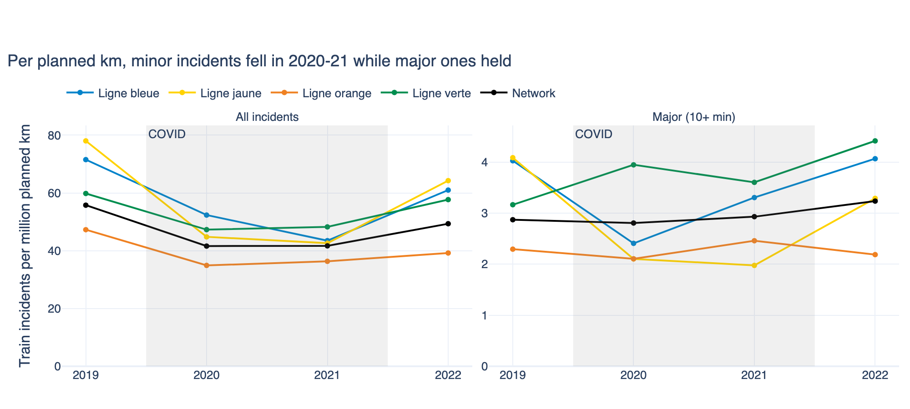
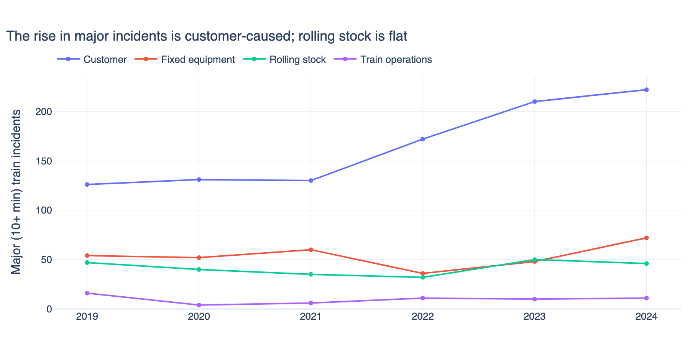

# Predicting Major STM Metro Service Interruptions

Technical challenge. The goal is a predictive framework for major metro interruptions on the STM network (Montréal), plus recommendations on how the STM should measure reliability, prioritize action and improve data collection.

## How to review

1. **Findings and recommendations for the STM:** [STM_RECOMMENDATIONS.md](STM_RECOMMENDATIONS.md), also as slides: [docs/slides/stm-recommendations.pdf](docs/slides/stm-recommendations.pdf).
2. **What the data can support, approach and technical results:** the rest of this README.

## Summary

- **The trend is not service volume.** Planned km fell 6% from 2019 to 2022, while major incidents per million km rose 50% from 2019 to 2023 (January-September).
- **Disruption is up, rolling-stock reliability is not.** Major train incidents went from 258 (2019) to 365 (2024), almost all of the rise customer-caused. Rolling stock is flat.
- **Prediction at declaration is weak.** Flagging the 10% highest-scored incidents catches about 20% of the major ones, against 16% using the symptom alone and 10% at random. A symptom x location table does as well as a logistic regression.

"Major" is not defined in the brief. I use a customer-service delay of 10 minutes or more (see Assumptions).

## Quickstart

Requires [uv](https://docs.astral.sh/uv/) (Python 3.12 is installed automatically).

```bash
uv sync                 # create .venv and install locked dependencies
uv run pytest           # run tests
uv run ruff check .     # lint
uv run pre-commit install  # once: ruff on commit
uv run jupyter nbconvert --to notebook --execute --inplace notebooks/*.ipynb  # re-run (figure export needs Chrome)
```

## Data

Two open datasets from the Ville de Montréal portal, published by the STM:

| Dataset | Rows | Coverage | Grain |
|---|---|---|---|
| Metro incidents | 45,561 | 2019-01 to 2025-09 | one incident |
| Planned metro kilometres | 8,472 | 2019-01 to 2023-09 | line x service period x day |

What the data can and cannot support:

1. **Only train incidents have a service delay.** The STM states that station incidents do not affect metro service ([dataset description](https://donnees.montreal.ca/dataset/incidents-du-reseau-du-metro)). Station incidents are left out of everything below.
2. **The official duration bin and the clock agree on 98.2% of train incidents.** The share that disagrees rises every year (1.16% in 2019, 2.27% in 2024), mostly the clock running long. The bin is the target.
3. **Both analyses use train incidents on a single named line:** 28,718 of the 29,167. Multi-line incidents and workshop and yard rows ("Non affecté") cannot be put on one line's km.
4. **The major-incident share is rising:** 10+ min went from 5.1% of these incidents in 2019 (258) to 7.3% in 2024 (365).
5. **2025 is incomplete.** April-September 2025 runs 15-52% below 2024, since train incidents can be published 30+ days after a month closes. 2025 is left out of every score and trend.
6. **Planned km must include the "unassigned" rows** (service period `#`). They hold 54% of 2019's km; dropping them would halve 2019 exposure and fake a trend. Km is planned, not actual, so cancelled service is not reflected, and it stops in September 2023.

## Analytical strategy

The question is whether the trend in incidents reflects reliability, service volume, reporting or classification. A model cannot answer that, so the work runs in this order:

1. **Audit the data first.** Each field misread gives a confident but wrong answer: station incidents counted as interruptions, unassigned km dropped, 2025 read as an improvement. What each field can support is settled before anything uses it (Data, above).
2. **Measure reliability as a rate, then split it.** Counts and the major share move with volume and with minor incidents; a rate per planned km does not. Splitting by line and by cause shows where the change is.
3. **Then predict, using only what is known at declaration.** Leakage is the main risk: several fields are filled in once the incident is over, and they predict the outcome very well because they record it.

**How the features were chosen.** Each field was screened by hand, in order: (1) is it known when the incident is declared, (2) is it usable (identifiers and near-empty fields out, rare locations grouped), (3) does its 10+ rate vary across values, (4) does it repeat another field (rolling stock repeats the symptom). Six fields pass. No automated subset search: with no validation set it would be scored on the test years, which inflates the result, and it would favour fields that record the outcome, such as evacuation.

**Model choice.** Three models, from simplest to least simple, to show what each step adds. The comparison is the result, not a search for the best model: all run on defaults, nothing is tuned, and no model is picked on the test years.

Choices in the prediction framework:

| Choice | What | Why |
|---|---|---|
| Population | Train incidents on a single line, 2019-2024 (25,756) | Line list timing of multi-line incidents is unclear; 2025 is incomplete |
| Target | 10+ min delay, from the official duration bin | 5+ is too common to escalate, 30+ too rare to model |
| Features | Symptom, line, location, hour, weekday, month | Known when the incident is declared |
| Excluded | Cause, power cut, evacuation, emergency team, resume time, duration | Set after the fact |
| Excluded | Emergency brake, door, material damage | Timing not documented |
| Not used | Rolling stock, vehicle, car door, run | Repeats the symptom, or an identifier |
| Models | 10+ rate of the symptom (baseline), 10+ rate of the symptom x location cell, logistic regression on all six features | Simplest first, to see what each step adds; no tuning |
| Validation | Test years 2022, 2023, 2024, each scored by models fit on the years before | No future information, and the 10+ share drifts over time |
| Metrics | Recall and precision when the top 10% of incidents are flagged, PR-AUC | Ops can escalate only a limited number of incidents |

## Assumptions

- **"Major" is a 10+ min customer-service delay.** Not defined in the brief; 5+ is the STM's indicator line, 10+ is rare enough to escalate.
- **Ops can escalate 10% of incidents.** The alert budget behind every recall figure.
- **The duration bin is the customer-service delay.** The field is missing from the data dictionary; it matches the documented delay times on 98.2% of train incidents.
- **Symptom, line and location are recorded when the incident is declared.** The STM documents cause as coming from a later analysis, not these.
- **Emergency brake, door and material damage may be filled in later.** Their timing is not documented, so they are left out.
- **Cause is attributed the same way every year.** The cause split depends on it and I cannot check it.
- **Planned km is a fair exposure.** Cancelled service is not reflected.
- **April-September 2025 is incomplete, not an improvement.** Consistent with the documented 30+ day publication lag.

## Findings

### Reliability



- **Volume does not explain the trend.** Planned km fell 6% from 2019 to 2022.
- **Until 2022 the share of major incidents rose mostly because minor incidents fell** (all incidents per km dropped 25% in 2020-21), not because major ones rose.
- **From 2023 major incidents themselves rose.** January-September, per million km: 2.74 in 2019, 4.11 in 2023. Km data stops in September 2023, so later years are counts: 335 in 2023, 365 in 2024.
- **No single line is the problem.** The green line jumped in the first quarter of 2023 (72 major incidents against 36 a year earlier and 39 a year later), then the orange line rose in 2024 (104 to 153).
- **The rise is customer-caused.** Within it, deliberate mischief went from 62 major incidents (2019) to 152 (2024). Rolling stock is flat; fixed equipment varies, then rises in 2024.



Cause is assigned by a later analysis, so a change in how causes are attributed would look the same as a real change. The symptom, recorded at declaration, also shows customer incidents rising.

### Prediction

Recall when the top 10% of incidents are flagged, in percent:

| Model | 2022 | 2023 | 2024 | All three years | Lead over symptom (95% interval) |
|---|---|---|---|---|---|
| Symptom rate (baseline) | 14.1 | 17.3 | 15.5 | 15.7 | |
| Symptom x location rate | 22.0 | 16.8 | 20.4 | 19.6 | +3.9 (1.3 to 6.6) |
| Logistic regression | 21.2 | 20.3 | 20.0 | 20.5 | +4.7 (2.2 to 7.1) |

- **The signal at declaration is weak.** Of the regression's alerts, 14-15% are major incidents, against a 10+ share of 6.6-7.6%.
- **The table and the regression tie** (difference 0.9 points, -2.3 to 3.8). The table is less steady from year to year and depends on how rare locations are grouped.
- **I also tried gradient-boosted trees during exploration.** They ranked no better and are not kept in the repository.

## Limitations

- **No per-km rate after September 2023.** The 2024 findings are counts.
- **Scores are not calibrated probabilities.** The 10+ share drifts up over the years.
- **Multi-line incidents are out of the model.** They are 351 rows but 11% of the 30+ min events.

## With more time

- **Re-score during the incident:** the chance of reaching 10 minutes given that 5 have passed. Elapsed time is likely the strongest signal, and it is what Ops would use.
- **Settle what is known at declaration** with the STM: the line list of multi-line incidents (11% of 30+ min events) and the emergency brake, door and material damage flags.

## Use of AI

I used Claude as a coding assistant: it drafted most of the code and I reviewed it. The analytical choices are mine: the target, what counts as leakage, which rows to keep and how to read each field.

## Repository structure

```
DS_challenge/
├── STM_RECOMMENDATIONS.md  # findings and recommendations for the STM
├── data/raw/          # source datasets as published (see data/README.md)
├── docs/
│   ├── figures/       # figures used in the reports
│   └── slides/        # STM_RECOMMENDATIONS.md as slides (HTML and PDF)
├── notebooks/         # run the code, show tables and figures, read the results
│   ├── 01_data_audit.ipynb   # evidence for the Data section of this README
│   ├── 02_reliability.ipynb  # incidents per million km, counts by line and cause
│   └── 03_model.ipynb        # backtest of the prediction framework
├── src/ds_challenge/
│   ├── data.py         # loading and cleaning
│   ├── reliability.py  # incidents per million planned km
│   ├── models.py       # the three models, as scikit-learn classifiers
│   ├── splits.py       # train/test splits by year
│   ├── evaluation.py   # alert budget, metrics, backtest, bootstrap
│   └── plots.py        # shared figure style and export
├── tests/             # loaders, features known at declaration, rate fallback, alert budget
├── .github/workflows/ # lint and tests on every push
├── pyproject.toml     # dependencies and tool config (uv)
└── uv.lock            # exact locked versions
```
