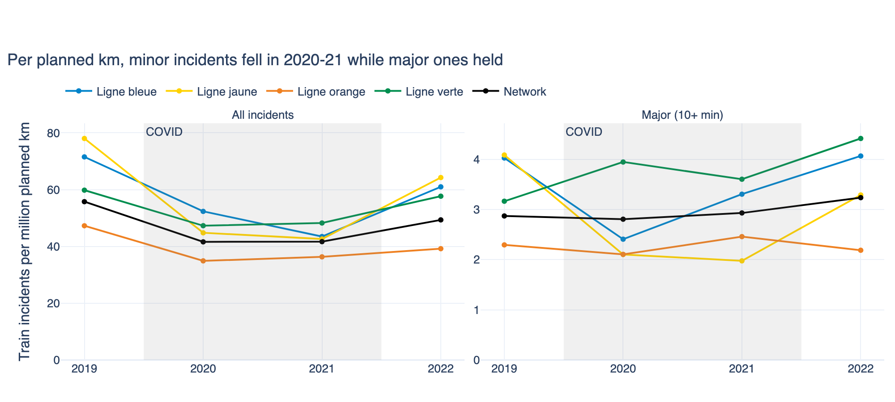
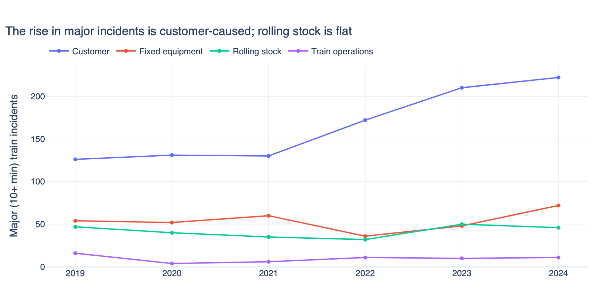

# Metro Incidents: What Changed and What to Do

Findings and recommendations for the STM, from the open metro incident data (2019-01 to 2025-09) and planned metro kilometres (2019-01 to 2023-09). Method, code and technical detail: [README.md](README.md). Slides: [docs/slides/stm-recommendations.pdf](docs/slides/stm-recommendations.pdf).

"Major" here means a customer-service delay of 10 minutes or more. The data does not define it; it is my assumption, to be set with Operations.

## The question

Direction sees trends in metro incidents and cannot tell whether they reflect reliability, service volume, reporting practices or classification consistency.

## The answer

| Explanation | Answer | Evidence |
|---|---|---|
| Service volume | No | Planned km fell 6% from 2019 to 2022, while major incidents per million km rose 50% from 2019 to 2023 (January-September) |
| Reporting practices | Partly | Every incident is recorded, even with no delay, so raw counts are not a service measure. April-September 2025 runs 15-52% short because train incidents are published late. The official duration and the clock disagree on a rising share of train incidents (1.16% in 2019, 2.27% in 2024), mostly the clock running long |
| Reliability | Disruption is up, equipment reliability is not | Major train incidents went from 258 (2019) to 365 (2024). Customer-caused ones went from 126 to 222; rolling stock from 47 to 46 |

Classification does not drive the trend: major incidents are counted from the incident type and the duration category alone. The split by cause depends on cause labels set by a later analysis, which I cannot check for consistency over time.

## What the raw data gets wrong

- **Station incidents are not service interruptions.** They are 36% of the file, and the STM states they do not affect metro service ([dataset description](https://donnees.montreal.ca/dataset/incidents-du-reseau-du-metro)). They are left out of everything below.
- **Station incidents get no cause by design.** The STM's methodology says the symptom is their cause, so the cause field only describes train incidents.
- **2025 looks like an improvement, but it is not complete.** Train incidents are published late, so April-September 2025 is left out.

## What changed, 2019-2024

- **Until 2022, the share of major incidents rose mostly because minor ones fell** during 2020-21. Major incidents stayed at 247-273 a year.
- **From 2023, major incidents rose.** Per million km, January-September: 2.74 in 2019, 4.11 in 2023. Km data stops in September 2023; counts continue to rise: 335 in 2023, 365 in 2024.
- **The line driving it changes.** The green line jumped in early 2023, then the orange line rose in 2024 (104 to 153).

## The rise is customer-caused

- Customer-caused major incidents: 126 (2019) to 222 (2024). Deliberate mischief alone: 62 to 152.
- Rolling stock is flat. Fixed equipment varies, then rises in 2024.
- Cause is assigned weeks later, so a change in how causes are recorded would look the same. The symptom, recorded when the incident is declared, also shows customer incidents rising.

## Can a major incident be predicted when it is declared?

- **Only weakly.** Flagging the 10% most at-risk incidents catches about 20% of the major ones, against 16% using the symptom alone and 10% at random.
- **A symptom x location table does as well as a statistical model.** It fits on a printed page.
- **It is a triage aid, not an escalation rule.** At a 10% alert budget it misses about 80% of major incidents.

## How to measure reliability

- **Use a rate:** major train incidents per million km, by line, monthly. Raw counts and the share of major incidents both move for reasons unrelated to reliability.
- **Report it in two parts:** controllable (rolling stock, fixed equipment, operations) and external (customer). They have moved differently since 2022 and call for different actions.
- **Keep station incidents out of the service measure.** They carry no service delay.
- **Do not report months that are still filling in.** Train incidents can be added 30+ days after a month closes.
- **Report 30+ min events as a rate with an interval.** There are about 70 a year.

## How to prioritize action

- **VP Operations:** the growth is in customer-caused incidents, mostly deliberate mischief, not in equipment. Watch the monthly rate by line, since the line that drives it changes. At declaration, the symptom x location table can order incidents for attention.
- **CFO:** this data cannot measure financial burden: it has no cost and no ridership. A usable proxy is delay-minutes by line and year, weighted by peak hours.
- **Public Affairs / Safety:** quote 30+ min events as rates with intervals, and do not quote 2025 figures yet. The triage table does not single out the severe events.

## How to improve data collection

- **Record the exact delay in minutes**, and document the duration field (it is missing from the data dictionary).
- **Timestamp each flag** (emergency brake, material damage, lines affected), so it is clear what is known when an incident is declared. This is what limits prediction most.
- **Publish km after September 2023**, and actual km next to planned km.
- **Add ridership and a cost per incident**, to answer the CFO and Public Affairs questions.
- **Mark which months are complete.**

## What this data cannot tell you

- **Cost and rider impact:** no cost, ridership or station volume data.
- **Per-km rates after September 2023:** the 2024 findings are counts.
- **Why customer-caused incidents rose:** that needs ridership and security data.
- **Whether causes are recorded consistently:** they are assigned by a later analysis.
